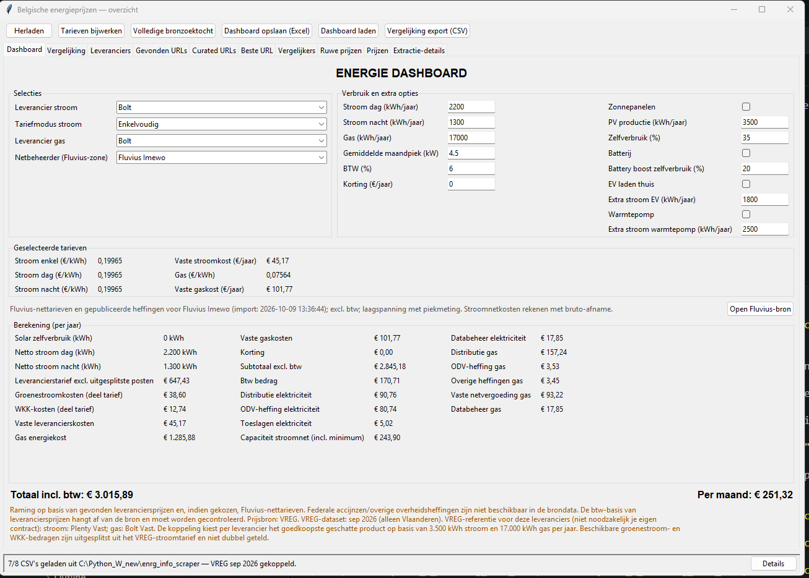
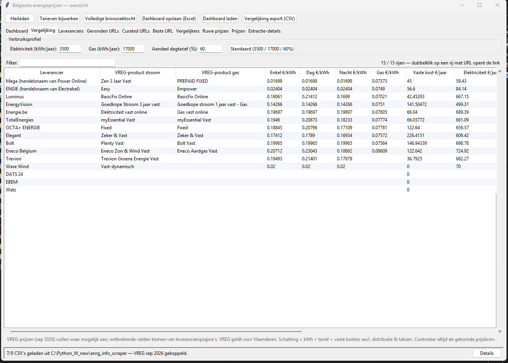
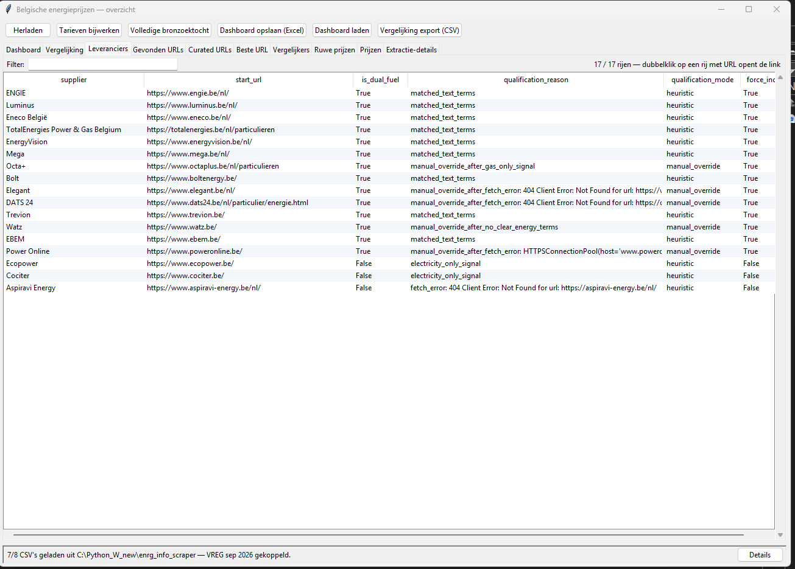
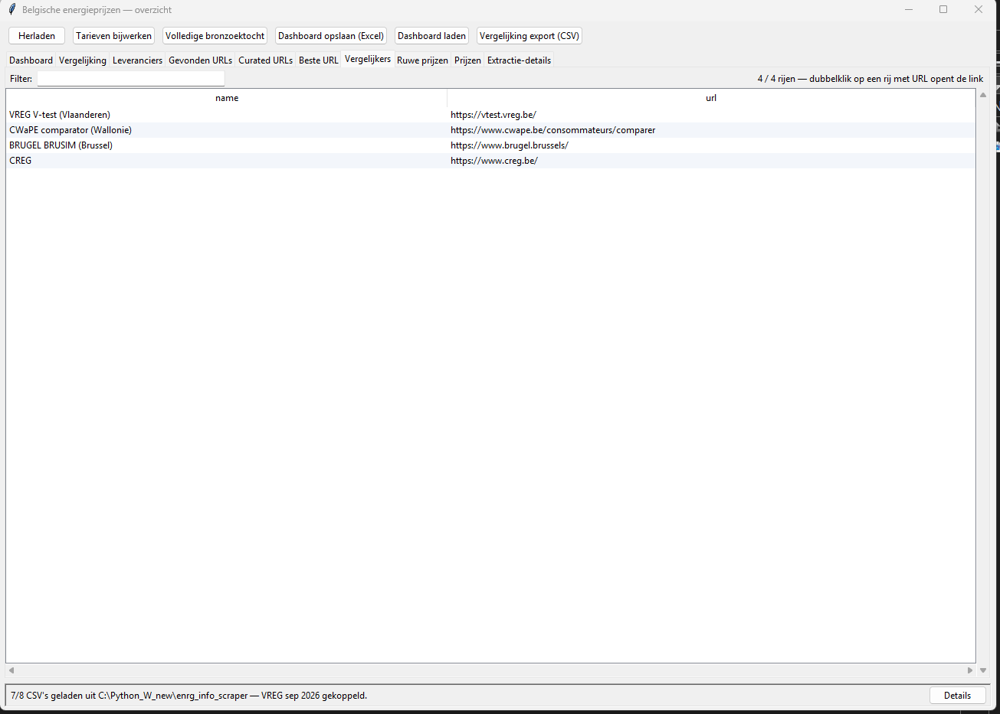

# Energie-Data-Scraper

Een desktopdashboard om Belgische energieprijzen van leveranciers te vergelijken. De app combineert VREG-referentietarieven, leveranciersgegevens en Fluvius-nettarieven.

## Installatie

Vereist Python 3.10 of nieuwer.

```powershell
py -m venv .venv
.\.venv\Scripts\Activate.ps1
python -m pip install -r requirements.txt
```

## Starten

```powershell
python energy_viewer.py
```

Gebruik **Tarieven bijwerken** in het dashboard om de Fluvius-, VREG- en leveranciersgegevens bij te werken. De eerste update kan langer duren omdat de leveranciers-URL's dan nog niet in de lokale cache staan.

De gegevens worden lokaal opgeslagen in `scraper_data/` en persoonlijke dashboardexports in `User_Data/`. Deze mappen worden bewust niet naar GitHub gepusht.

## Screenshots

### Dashboard



### Vergelijking



### Leveranciers



### Vergelijkers



### Gevonden URL's


